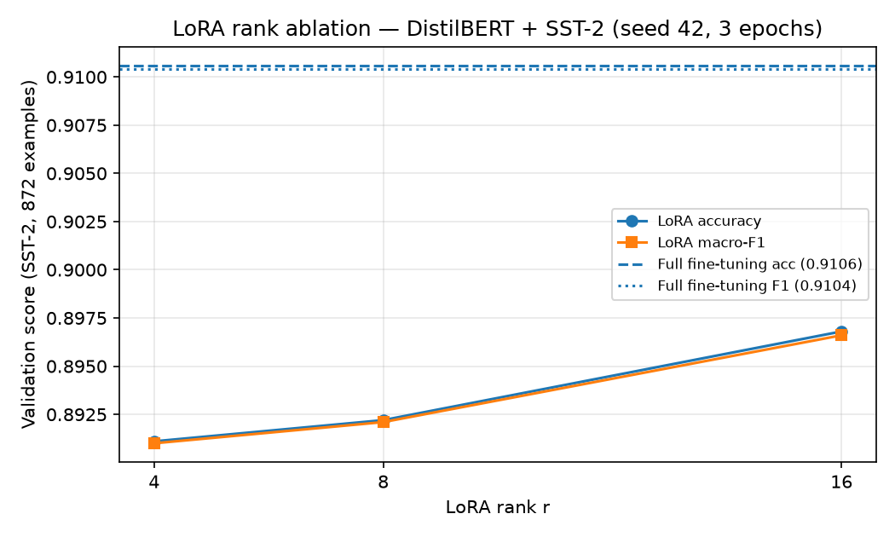
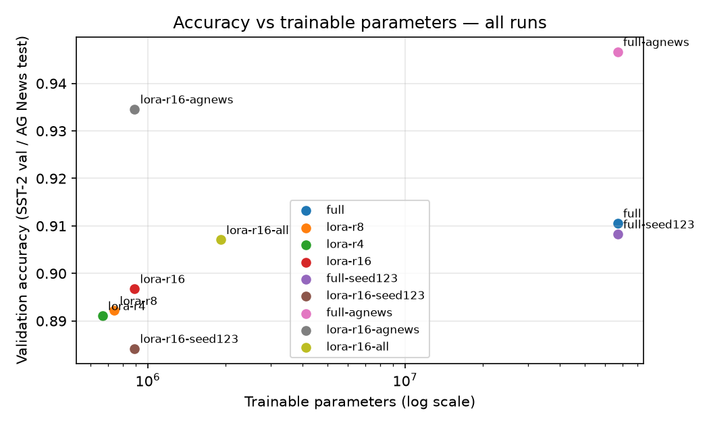
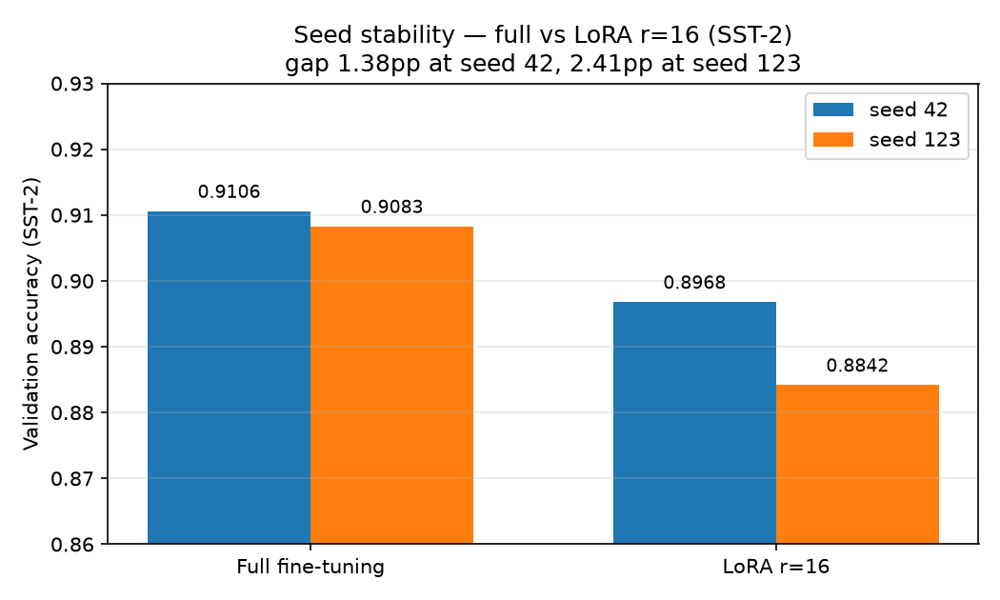
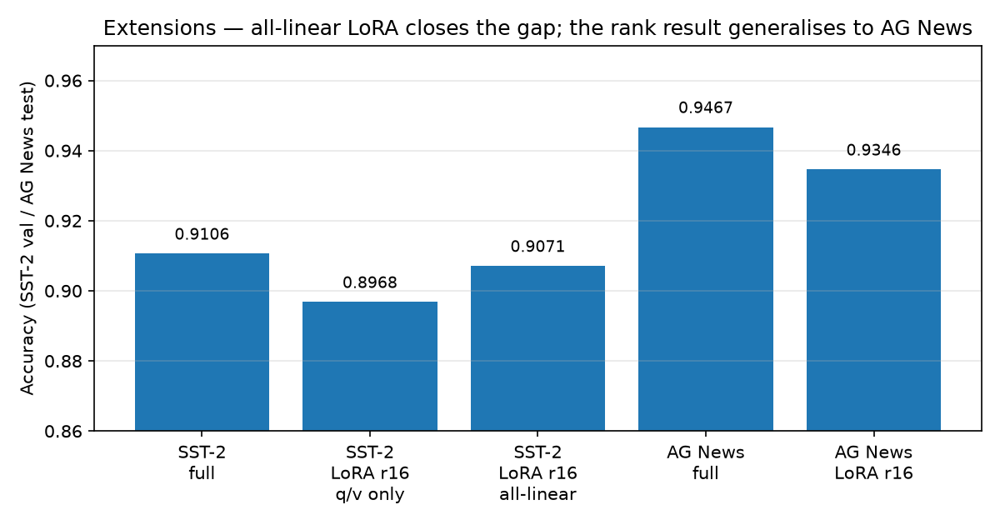

# Reproducing LoRA: Low-Rank Adaptation for Efficient Fine-Tuning — With a Rank Ablation Study

[](https://colab.research.google.com/github/sujalgiriiitp-source/Lora---reproduction-/blob/main/notebooks/03-lora.ipynb)
[](https://www.python.org/)
[](LICENSE)

A research-reproduction project. It asks one question and answers it with
measured numbers — not with a demo:

> **How much accuracy does full fine-tuning lose when you replace it with
> LoRA, and how does that trade-off change as the LoRA rank `r` changes?**

The base model is **DistilBERT** (`distilbert-base-uncased`), the task is
sentiment classification on **SST-2** (GLUE), and the comparison is:

| Run | What changes |
| --- | --- |
| Full fine-tuning | All ~66M parameters updated |
| LoRA r=4 | Only low-rank adapters updated (~0.1% of parameters) |
| LoRA r=8 | Same, larger rank |
| LoRA r=16 | Same, largest rank in this study |

Every run logs accuracy, F1, trainable-parameter count, and training time to
`experiments/runs.csv`, so the results table in this README and in
[`report/report.md`](report/report.md) can be checked against the raw log.

## Results

> **Status: 9 runs complete — 11 Nov 2026, Colab T4 GPU.**
> Every number below is copied from [`experiments/runs.csv`](experiments/runs.csv).
> The planned smoke test (200 examples, 1 epoch, CPU) was never run — the
> full runs superseded it. See [`SMOKE_TEST_LOG.md`](SMOKE_TEST_LOG.md).

| Run | Model | Trainable params | Accuracy | F1 | Train time |
| --- | --- | --- | --- | --- | --- |
| Full FT | DistilBERT | 66,955,010 (100%) | 0.9106 | 0.9104 | 689.6 s |
| LoRA r=4 | DistilBERT + LoRA | 665,858 (0.99%) | 0.8911 | 0.8910 | 466.0 s |
| LoRA r=8 | DistilBERT + LoRA | 739,586 (1.10%) | 0.8922 | 0.8921 | 504.2 s |
| LoRA r=16 | DistilBERT + LoRA | 887,042 (1.32%) | 0.8968 | 0.8966 | 480.6 s |

Accuracy rises with rank (r=4 → 0.8911, r=8 → 0.8922, r=16 → 0.8968, full
→ 0.9106). The closest rank, r=16, matches full fine-tuning within
1.38 percentage points using 1.32% of the trainable parameters. Gaps
between adjacent ranks are small (validation set: 872 examples), so only
the rank ordering — not the small gaps — is claimed.

### Extensions (same day, same setup)

| Run | Setting | Trainable params | Accuracy | F1 | Train time |
| --- | --- | --- | --- | --- | --- |
| Full FT, seed 123 | SST-2 | 66,955,010 (100%) | 0.9083 | 0.9081 | 737.0 s |
| LoRA r=16, seed 123 | SST-2 | 887,042 (1.32%) | 0.8842 | 0.8840 | 510.6 s |
| Full FT | AG News (test 7,600) | 66,956,548 (100%) | 0.9467 | 0.9467 | 3,296.8 s |
| LoRA r=16 | AG News (test 7,600) | 888,580 (1.31%) | 0.9346 | 0.9346 | 2,457.2 s |
| LoRA r=16, all-linear | SST-2 | 1,919,234 (2.79%) | 0.9071 | 0.9070 | 639.0 s |

**What the extensions show:**

- **Seed stability (honest correction to the headline):** the full-vs-r16
  gap is 1.38pp at seed 42 but 2.41pp at seed 123 (r16: 0.8968 → 0.8842).
  The "within 1.38pp" headline is a seed-42 number, not a stable property
  — across the two seeds the gap is 1.4–2.4pp (mean ≈ 1.9pp).
- **All-linear LoRA closes most of the gap:** targeting all linear layers
  (`q_lin, k_lin, v_lin, out_lin, lin1, lin2`) at r=16 reaches 0.9071 —
  1.03pp above q/v-only r=16 and only 0.35pp below full fine-tuning —
  with 1.92M trainable parameters (2.79%).
- **The rank result generalises to AG News:** full 0.9467 vs LoRA r=16
  0.9346, a 1.21pp gap — same order as SST-2, on a 4-class task with
  120,000 training examples.






Figures are generated from `experiments/runs.csv` by
[`scripts/plot_ablation.py`](scripts/plot_ablation.py) — re-run it after
new rows arrive.

Full-run settings: SST-2 train (67,349 examples), validation
(872 examples), 3 epochs, batch size 32, learning rate 2e-5 (full) /
1e-4 (LoRA), max sequence length 128, seed 42 (seed 123 for the repeat).
AG News: train 120,000, test 7,600, same epochs/batch/lr. See
[`experiments/README.md`](experiments/README.md) for the exact columns.

**Provenance note (11 Nov 2026):** the extension session's GPU VM
disconnected after the last run, so `experiments/runs.csv` was rebuilt
from the trainer outputs saved in the session notebook (Drive,
`05-extension-runs.ipynb`). Rows 1–4 are the original log; rows 5–9 are
the rebuilt rows. Two transcription errors in the rebuilt copy's old rows
were corrected against the original log (r=8 total params, r=4 F1). The
all-linear run's `notes` field was restored from the flag it provably
used (1,919,234 trainable params). No accuracy number was estimated or
adjusted.

**Environment note (11 Nov 2026):** on Colab, `requirements.txt`'s
`accelerate<1.0` broke with transformers 4.57.6 (upgraded to 1.15.0) and
torchao 0.10.0 broke peft 0.21.2 (removed). `requirements.txt` now pins
`accelerate>=1.0,<2.0`.

## Why this project exists

Large language models are expensive to fine-tune: updating every weight
needs the optimizer state for every weight. LoRA (Hu et al., 2021) freezes
the pre-trained weights and injects trainable low-rank matrices into the
attention layers, so a model can be adapted with a fraction of the
trainable parameters.

Reproducing a paper — running its method yourself, measuring where it
matches and where it differs, and changing one variable (here, the rank)
to see what happens — is the clearest small-scale evidence of research
readiness: it shows you can read a method, implement it faithfully, and
reason about results.

## Repository layout

```text
Lora---reproduction-/
├── README.md                  # this file
├── LICENSE                    # MIT
├── requirements.txt           # pinned-ish dependencies
├── src/
│   ├── train.py               # full / LoRA training, one entry point
│   ├── evaluate.py            # evaluate a saved checkpoint on validation
│   └── utils.py               # seeding, metrics, logging helpers
├── notebooks/
│   ├── 01-paper-summary.ipynb         # what LoRA claims, in my own words
│   ├── 02-baseline-full-finetune.ipynb # full fine-tuning, step by step
│   ├── 03-lora.ipynb                  # LoRA r=8, step by step
│   └── 04-ablation-analysis.ipynb     # r=4/8/16 compared, with plots
├── experiments/
│   ├── runs.csv               # one row per run (append-only log)
│   └── README.md              # column definitions
└── report/
    └── report.md              # 2-page report draft (Question / Method /
                               #   Results / Limitations / Next steps)
```

## How to run

### Option A — Google Colab (recommended, free GPU)

1. Open [`notebooks/03-lora.ipynb`](https://colab.research.google.com/github/sujalgiriiitp-source/Lora---reproduction-/blob/main/notebooks/03-lora.ipynb) in Colab.
2. Runtime → Change runtime type → **T4 GPU**.
3. Run all cells. The first cell installs the dependencies from
   `requirements.txt`.
4. Each notebook saves its run to `experiments/runs.csv` (download it from
   Colab and commit it here — results are only real when the log is in
   the repo).

Colab links for every notebook:

- [01 — Paper summary](https://colab.research.google.com/github/sujalgiriiitp-source/Lora---reproduction-/blob/main/notebooks/01-paper-summary.ipynb)
- [02 — Full fine-tuning baseline](https://colab.research.google.com/github/sujalgiriiitp-source/Lora---reproduction-/blob/main/notebooks/02-baseline-full-finetune.ipynb)
- [03 — LoRA](https://colab.research.google.com/github/sujalgiriiitp-source/Lora---reproduction-/blob/main/notebooks/03-lora.ipynb)
- [04 — Ablation analysis](https://colab.research.google.com/github/sujalgiriiitp-source/Lora---reproduction-/blob/main/notebooks/04-ablation-analysis.ipynb)

> These links work once the repository is public on GitHub under
> `sujalgiriiitp-source/Lora---reproduction-` (see
> [`PUSH_INSTRUCTIONS.md`](PUSH_INSTRUCTIONS.md)).

### Option B — Locally

```bash
git clone https://github.com/sujalgiriiitp-source/Lora---reproduction-.git
cd Lora---reproduction-
python -m venv .venv && source .venv/bin/activate
pip install -r requirements.txt

# Full fine-tuning (small subset, for a quick check)
python src/train.py --mode full --epochs 1 --max-train 2000 --output runs/full

# LoRA r=8
python src/train.py --mode lora --r 8 --epochs 3 --output runs/lora-r8

# Evaluate a saved checkpoint
python src/evaluate.py --checkpoint runs/lora-r8 --mode lora --r 8
```

Full SST-2 training needs a GPU (or a very patient CPU). The planned
local CPU smoke test uses only 200 training examples for 1 epoch — it
would prove only that the pipeline runs, it is not a result, and it has
not run yet. See [`SMOKE_TEST_LOG.md`](SMOKE_TEST_LOG.md).

### Reproducing the ablation (the core of this project)

```bash
python src/train.py --mode full --epochs 3 --output runs/full
python src/train.py --mode lora --r 4  --epochs 3 --output runs/lora-r4
python src/train.py --mode lora --r 8  --epochs 3 --output runs/lora-r8
python src/train.py --mode lora --r 16 --epochs 3 --output runs/lora-r16
```

Then open `notebooks/04-ablation-analysis.ipynb`, point it at
`experiments/runs.csv`, and generate the comparison plots. Keep every other
setting identical across runs — same seed, same data, same epochs — or the
rank comparison is meaningless.

## Method in brief

- **Dataset:** SST-2 (Stanford Sentiment Treebank, binary), via the
  `datasets` library (`nyu-mll/glue`, config `sst2`). Train 67,349 /
  validation 872. If SST-2 is unavailable, the code accepts
  `--dataset ag_news` as a documented fallback (4-class news
  classification) — the dataset actually used is recorded in every run
  row, so a switch is visible, not silent.
- **Model:** `distilbert-base-uncased`, sequence classification head.
- **LoRA config:** `r ∈ {4, 8, 16}`, `lora_alpha = 2r`, `lora_dropout = 0.1`,
  target modules `q_lin` and `v_lin` (DistilBERT attention), task type
  `SEQ_CLS`. This follows the LoRA paper's convention of scaling the
  adapter by `alpha / r`.
- **Optimiser:** AdamW, lr 2e-5 (full) / 1e-4 (LoRA), cosine schedule,
  warmup ratio 0.1, weight decay 0.01, batch 32 (GPU) / 8 (CPU smoke
  test), max length 128, seed 42.
- **Metrics:** accuracy and macro-F1 on the validation split, plus
  trainable-parameter count and wall-clock training time.

## Limitations (honest)

- DistilBERT is small and SST-2 is a single, easy task; a rank that wins
  here need not win on a harder task or a larger model.
- SST-2 validation is only 872 examples, so differences under ~1–2
  percentage points are within noise — the report says this explicitly.
- The LoRA paper's headline results are on GPT-3 / RoBERTa-large; this
  reproduction tests the *method* on a small model, it does not replicate
  their numbers.
- No hyperparameter search was run; learning rates are the standard
  defaults for this setup, not tuned optima.

## Citation

```bibtex
@inproceedings{hu2021lora,
  title     = {LoRA: Low-Rank Adaptation of Large Language Models},
  author    = {Hu, Edward J. and Shen, Yelong and Wallis, Phillip and
               Allen-Zhu, Zeyuan and Li, Yuanzhi and Wang, Shean and
               Wang, Lu and Chen, Weizhu},
  booktitle = {International Conference on Learning Representations},
  year      = {2022},
  url       = {https://arxiv.org/abs/2106.09685}
}
```

Also: Sanh et al., DistilBERT (2019), arXiv:1910.01108; Socher et al.,
SST-2 / GLUE (Wang et al., 2018).

## Author

**Sujal Giri** — B.Tech CSE (SIET, 2028) and B.S. Computer Science &
Data Analytics (IIT Patna, 2029). Built as a research-reproduction
project for research-internship applications. Contact via GitHub:
[@sujalgiriiitp-source](https://github.com/sujalgiriiitp-source).
